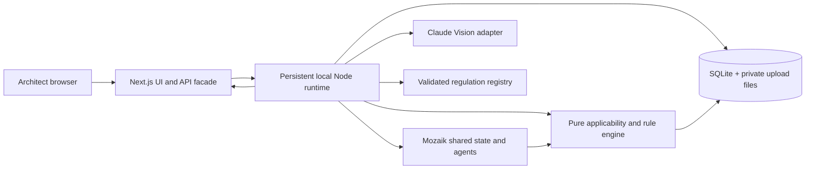

# Archilles technical constitution

Version: 1.1, 30 October 2026. This is an implementation target, not a description of completed features. The repository contains a Next.js 16.4.3 App Router starter and the shared C0 domain/API/event contracts in `src/domain/`; it has no application backend or viewer yet. Follow the preserved Next.js rule in `../Agents.MD` and read the relevant installed `node_modules/next/dist/docs/` guide before writing Next.js code. `DB.md` owns domain types, `Agents.MD` owns Mozaik contracts, and `PrD.md` owns requirements.

## 1. Architecture and decisions

The Next.js process owns rendering, upload forwarding, same-origin API endpoints, and SSE forwarding. The runtime process owns project data, files, Mozaik, Claude calls, rules, and events. It listens on `127.0.0.1` only in the MVP. Browser code never receives the Anthropic key, raw filesystem paths, or direct SQLite access. The runtime persists event summaries and findings before sending them to subscribers. The UI rehydrates by fetching current project/session state after reconnect.

| ADR | Decision | Why and tradeoff |
|---|---|---|
| ADR-01 | One local Node runtime plus Next.js facade | Keeps Mozaik alive across requests and exposes a small HTTP boundary; requires two dev processes. |
| ADR-02 | SQLite and private local files | Transactional revision/evidence/finding writes without an account; single-host MVP only. |
| ADR-03 | Shared strict TypeScript/Zod domain contracts | Prevents drift among four workstreams; requires schema-first integration. |
| ADR-04 | Deterministic bounded DSL and reviewed evaluators | Numeric and applicability results are reproducible; unsupported legal requirements return `NEEDS_REVIEW`. |
| ADR-05 | Claude Vision for suggestions, user confirmation for uncertain dimensions | Demonstrates useful extraction without converting pixels or model confidence into measurements. |
| ADR-06 | One selected page per review session | Supports PDFs without misleading cross-floor analysis; multi-page projects remain a later milestone. |
| ADR-07 | SSE for real agent activity, normal HTTP for commands | Simple local streaming and reconnection; not a distributed queue. |

Do not add Kubernetes, cloud storage, a vector database, or hosted authentication for the hackathon. Native Node process continuity is required: do not instantiate Mozaik per Next.js request or deploy the runtime as a serverless handler.

## 2. Repository and development environment

Repository-root layout after implementation: `app/` for routes and UI; `src/domain/` for `DB.md` types and Zod schemas; `src/rules/` for registry, applicability, pure engine, and fixtures; `src/geometry/` for normalization and evidence; `runtime/` for the persistent HTTP server, Mozaik participants, Claude adapter, persistence, and event stream; `data/` for ignored local state; `tests/` for pure, agent, and integration tests. Keep product code out of constitution documents.

Pin Node 24 for the local demo and record exact package versions in the lockfile when coding begins. Required direct dependencies are `@mozaik-ai/core`, `@anthropic-ai/sdk`, Zod, `better-sqlite3`, `pdfjs-dist`, and `react-konva`/`konva`. Keep PDF rendering and overlay transforms in browser-only components; perform a small bundling and coordinate-alignment smoke test before building the full viewer. Tailwind already exists. Use the existing project's icon system if one emerges; otherwise create one shared SVG arrow component. Never render UI arrows as Unicode, HTML entities, icon fonts, or CSS `content`.

`.env.example` contains only server-side variable names and local defaults. Confirm model IDs against installed Mozaik support and Anthropic availability before adding them. Add `npm run dev:runtime` for the persistent process, `npm run dev:web` for Next, and `npm run dev` to start both when the runtime exists. Run `npm ci`, `npm run lint`, `npx tsc --noEmit`, `npm test`, then `npm run build` as the minimum check sequence. The C0 package already has a contract test script; future owners add their own tests to the command.

## 3. End-to-end data flow

1. The browser creates a `Project` with jurisdiction `RS`, purpose `OFFICE`, project phase, and only available metadata. The runtime persists revision 1.
2. Upload validation checks MIME signature, extension, byte size (MVP limit 20 MiB), and PDF page count (MVP limit 20). Store the original privately; select one page and render it at a fixed analysis resolution. Record the original dimensions, rendered dimensions, selected page, and transform. EXIF rotation is normalized for images. Reject encrypted PDFs, corrupt files, and files without a renderable page with a clear error.
3. The Geometry Agent receives the selected page once per drawing hash/page/model/prompt version. Claude Vision suggests elements and reads labels into a strict schema. Preserve bounding boxes and raw text. If no reliable dimensional evidence exists, ask the user for a dimension or scale calibration. Never infer a physical dimension solely from pixels.
4. Concurrently, the Regulation Agent reads project metadata and `ACTIVE` rule metadata and selects candidate applicability. It can request classification or measurements. The authoritative applicability engine independently evaluates the bounded rule conditions before any numeric check.
5. The pure Rule Engine consumes active versioned rules plus validated project geometry and measurements, returns `RuleEvaluation`, and stores its evidence IDs. The Review Agent creates explanations linked to these results, without changing status. The UI renders finding markers in source-page coordinates.
6. Fix & Recheck accepts a proposed value and base revision. It overlays a hypothetical value in memory, reevaluates only dependent rules, and returns a before/after result. Persist a `ReviewAction`, not a new project measurement. A separately confirmed correction creates a new project revision and invalidates affected findings.

The source page coordinate system is top-left origin, x right, y down, in pixels of the original page render. Viewer zoom/pan is a presentation transform only. Persist geometry in source coordinates and use one explicit affine transform for overlay rendering and hit testing. For PDF pages, persist the render DPI and page rotation. `metresPerPixel` is absent until the user confirms two points or an unambiguous labeled span. A route length can be checked only from a validated traversability graph with wall/door connectivity; straight-line paths through walls are forbidden.

## 4. Rules and regulatory intelligence

The regulatory pipeline has eight stages: authoritative source capture with metadata and hash; segmentation into articles, paragraphs, tables, definitions, and cross-references; AI candidate extraction; independent AI validation; applicability modeling; mapping to a bounded DSL or reviewed pure evaluator; human provision and test review; explicit activation in the registry. Ingestion runs outside the live project-analysis critical path. Every candidate retains original-language source references and issues; an AI reviewer cannot set `HUMAN_VERIFIED` or `ACTIVE`.

The first registry targets the official [fire regulation, 22/2019-3](https://pravno-informacioni-sistem.rs/SlGlasnikPortal/reg/viewAct/ec3c54bc-de4a-433f-afa8-d9eb44b7dab1) and [accessibility regulation, 22/2015-95 with 10/2026-89](https://pravno-informacioni-sistem.rs/SlGlasnikPortal/reg/viewAct/512f4f2c-4bc4-4c31-a335-409673b7fac5). Articles 29 and 31–34 of the fire regulation are investigation leads, not preapproved rule IDs. The accessibility regulation's ramp provisions include conditional alternatives; no single unconditional slope threshold can represent them. Source text, amendments, effective date, building classification, exceptions, and referenced standards require verification before a rule is active. If a requirement depends on information not present in the drawing, return `UNKNOWN` or `NEEDS_REVIEW`, not a guessed result.

Rule engine order: verify lifecycle/source version; resolve jurisdiction and effective date; evaluate applicability and exception conditions in three-valued logic; validate required inputs and their provenance; normalize units; run the bounded evaluator; emit a trace. A proven exception yields `NOT_APPLICABLE` with reason. Unknown applicability or missing data yields `UNKNOWN`; unresolved interpretation or unsupported evaluator yields `NEEDS_REVIEW`. `PASS`/`FAIL` require an applicable `ACTIVE` rule and sufficient verified input. Severity is separate from status and appears only when documented.

The MVP target is 3–5 tests across both regulations, chosen by a human reviewer from provisions with unambiguous scope and inputs. Each active rule requires pass, fail, boundary, missing-data, non-applicable, and exception tests when relevant. A candidate count is never reported as executable coverage. Longer term, add ingestion breadth and candidate review UI without automatically increasing active coverage.

## 5. API and event transport

Next.js Route Handlers proxy to the runtime and validate request/response schemas. The installed Next.js docs specify `app/**/route.ts` and uncached request-time GET handlers by default; inspect the specific local guide before implementation. Use JSON for commands and `multipart/form-data` for upload. All IDs are opaque. Return a standard error body `{ code, message, retryable, details? }`; never return stack traces, secrets, or absolute file paths.

| Method and route | Request | Success response |
|---|---|---|
| `POST /api/projects` | Project creation fields | `Project` |
| `GET /api/projects/:id` | none | `Project` with latest revision |
| `PATCH /api/projects/:id` | `{ baseRevision, patch }` | New `ProjectRevision`, updated `Project` |
| `POST /api/projects/:id/drawings` | multipart file + `baseRevision` | `Drawing`, available page count |
| `GET /api/drawings/:id/pages/:page` | none | Page image/PDF stream, private same-origin |
| `POST /api/projects/:id/analyses` | `{ projectRevision, drawingId, page }` | `{ sessionId, status: "RUNNING" }` |
| `GET /api/analyses/:id` | none | `AnalysisSession`, elements, evaluations, findings, coverage counts |
| `GET /api/analyses/:id/events?after=<sequence>` | SSE | Stored `AgentEvent` stream with ordered IDs |
| `PATCH /api/elements/:id/measurements` | `{ baseRevision, metric, value, unit, evidenceIds }` | New revision and measurement |
| `POST /api/projects/:id/rechecks` | `{ baseRevision, elementId, metric, proposedValue, unit }` | `ReviewAction`, before/after evaluations |
| `GET /api/projects/:id/coverage` | none | Source and rule counts by lifecycle and evaluation status |

Use `409 REVISION_CONFLICT` if the base revision is stale; `422` for invalid inputs; `413` for oversized files; `503` for unavailable runtime or AI. A project analysis is idempotent for the same revision, drawing hash/page, active rule-set version, and extraction version; return the existing session or explicitly request a new run. Uploads and corrections create revisions. Agent events carry `{ eventId, sessionId, projectRevision, sequence, type, producerId, payload, occurredAt }`. `Last-Event-ID` or `after` resumes stored events; the UI ignores duplicate sequence numbers. Heartbeats keep SSE open but are not shown as agent work. Do not stream provider raw response content or confidential image data to the activity panel.

The coverage response must separately count `indexedProvisions`, `candidateRules`, `humanVerifiedRules`, `activeRules`, `applicableRules`, `executedChecks`, `blockedUnknown`, `needsReview`, and `outsideAutomatedCoverage`. Counts have explicit denominators; no global compliance percentage. The source list includes version, verification state, and considered/not considered reason.

## 6. Runtime, AI, and failure handling

`@mozaik-ai/core` 4.2.0 exposes `defineRuntime`, `RuntimeState`, `createAgent`, `createHuman`, `SemanticEvent`, `SituationSpecification`, and `SituationHandler`. `defineRuntime` returns `initializeRuntime`, `join`, `sendEvent`, and `runLoop`; those functions are **not** top-level package exports. Initialize once per persistent process. Mozaik's `runLoop` returns `void`; processors are not awaited. The runtime must therefore track completion through events/state and guard duplicate work. See `../Agents.MD` for ownership and event contracts. The installed `UserMessageItem` is text-only, so image bytes should pass through a server-side Claude Vision adapter invoked by a geometry agent tool, while Mozaik remains the genuine coordination runtime. Verify this adapter with a small real integration test before promising live extraction.

Cap AI work per session: one image extraction call per drawing page/version, at most one bounded clarification call per unresolved item, and one concise Review Agent explanation batch. Use exact cached geometry on repeat runs and deterministic rechecks without AI. Track token usage and estimated dollars per `AgentRun`; stop new calls at the configured budget and return `PARTIAL` with explicit blocked reasons. Limit retries to one for transient provider errors with backoff; never retry schema-invalid output blindly. Input from uploaded plans and regulatory texts is untrusted data, not instructions. Validate and constrain all model JSON with Zod, reject unexpected fields, and log parse failures without exposing raw documents.

If Claude is unavailable, retain upload/viewer, confirmed geometry, registry, deterministic checks, and recheck. A preconfirmed fixture may be loaded for a disclosed demo path, but findings must be freshly computed from fixture data. If the runtime restarts, mark in-flight sessions interrupted, then let the user start a new analysis; do not emit fabricated progress. If a rule source cannot be verified, keep it inactive and show it as coverage gap. If an event handler fails, record `agent.run.failed`, preserve session revision, and allow independent agents to finish; the session becomes `PARTIAL` where possible.

## 7. Security, testing, and milestones

Uploads are confidential: validate signatures, file size, PDF renderability, and page count; isolate storage; avoid public `/public` paths; set CSP and content type headers; rate-limit local analysis requests to one active AI extraction per project; never log API keys or base64 image content. The local single-user setup is not a hosted security boundary. Before any cloud deployment, add authentication, authorization, encrypted storage, and retention controls.

Test pure rule functions for applicability, exceptions, thresholds, boundary precision, unit conversion, and missing evidence. Test geometry transform round trips, page rotation, scale refusal, and corrected measurements. Mock the Claude adapter for deterministic integration tests but perform one real, budgeted smoke test before demo. Test Mozaik events, shared state, concurrency, duplicate suppression, stale revision rejection, restart recovery, and two distinct drawings whose outcomes differ. Run a full demo rehearsal offline from a disclosed confirmed fixture and online from a real image; record latency and cost.

| Milestone | Dependency and acceptance | Drop if time runs short |
|---|---|---|
| M0: contracts and sources | Shared schemas compile; official provisions checked; first active rule has source and tests | Broad ingestion UI |
| M1: vertical slice | Confirmed geometry -> Mozaik selection -> deterministic evaluation -> source-backed overlay -> recheck | Polished dashboard extras |
| M2: real input | PDF/PNG/JPG upload, selected page, Vision suggestions, user confirmation | Automatic multi-page analysis |
| M3: breadth | 3–5 active checks across both regulations; coverage counts; two-plan tests | 8–12 stretch checks |
| M4: demo hardening | Recorded real events, fallback fixture, cost cap, error states, repeatable rehearsal | PDF export, accounts, cloud deployment |

The shared C0 schemas/API/events are complete. Four workstreams can proceed now: frontend consumes shared schemas/API; geometry produces `ArchitecturalElement`/`Measurement`/`Evidence`; regulatory work owns source registry and applicability; runtime owns Mozaik/events/persistence and the pure evaluator. Merge at M1, then integrate each feature vertically. The next regulatory coding task is one source-verified active rule fixture plus evaluator test; other branches can build against `src/domain/fixtures.ts` meanwhile. See `TEAM.md` for exact file ownership.
