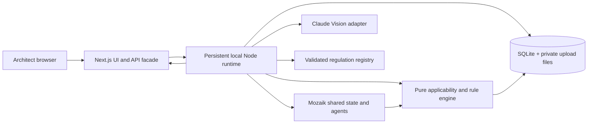

# Archilles technical constitution

Version: 1.1, 30 October 2026. This is an implementation target, not a description of completed features. The repository contains a Next.js 16.4.3 App Router starter and the shared C0 domain/API/event contracts in `src/domain/`; the application now includes a persistent runtime, viewer, private upload and review flow; later ADRs describe the implemented behavior. Follow the preserved Next.js rule in `../Agents.MD` and read the relevant installed `node_modules/next/dist/docs/` guide before writing Next.js code. `DB.md` owns domain types, `Agents.MD` owns Mozaik contracts, and `PrD.md` owns requirements.

## 1. Architecture and decisions

The Next.js process owns rendering, upload forwarding, same-origin API endpoints, and SSE forwarding. The runtime process owns project data, files, Mozaik, Claude calls, rules, and events. It listens on `127.0.0.1` only in the MVP. Browser code never receives the Anthropic key, raw filesystem paths, or direct SQLite access. The runtime persists event summaries and findings before sending them to subscribers. The UI rehydrates by fetching current project/session state after reconnect.

| ADR | Decision | Why and tradeoff |
|---|---|---|
| ADR-01 | One local Node runtime plus Next.js facade | Keeps Mozaik alive across requests and exposes a small HTTP boundary; requires two dev processes. |
| ADR-02 | SQLite and private local files | Transactional revision/evidence/finding writes without an account; single-host MVP only. |
| ADR-03 | Shared strict TypeScript/Zod domain contracts | Prevents drift among four workstreams; requires schema-first integration. |
| ADR-04 | Deterministic bounded DSL and reviewed evaluators | Numeric and applicability results are reproducible; unsupported legal requirements return `NEEDS_REVIEW`. |
| ADR-05 | Claude Vision for suggestions, user confirmation for uncertain dimensions | Demonstrates useful extraction without converting pixels or model confidence into measurements. |
| ADR-06 | One selected page per review session | Supports PDFs without misleading cross-floor analysis; multi-page projects remain a later milestone. |
| ADR-07 | SSE for real agent activity, normal HTTP for commands | Simple local streaming and reconnection; not a distributed queue. |
| ADR-08 | Private server-side page normalization; browser-only viewer transforms | Integration requires a trusted raster without uploading client-derived geometry. The local runtime uses PDF.js legacy with native canvas and Sharp; adds two pinned native dependencies. This replaces the earlier browser-only PDF preparation restriction, under the user-authorized integration task. |

ADR-09: Geometry and Regulation use Mozaik `runLoop` with registered, task-scoped tools and private batch contexts. One tool invocation and two controller inferences are the hard limits; the Vision adapter remains server-side and arithmetic/applicability remain pure code. Review consumes persisted evaluations through its existing loop. Native loop IDs/state names are persisted separately from the allowlisted application SSE events. Regulation uses the configured Review model for text selection explanations; Geometry uses the configured Vision model for its controller and image adapter. Controller and image token costs are aggregated on their task run.

ADR-10: The AI budget has two caps checked on every reservation: the configured total (`ARCHILLES_AI_BUDGET_USD`, default 20) and a rolling one-hour spend cap (`ARCHILLES_AI_HOURLY_LIMIT_USD`, default 3). Hourly spend is recorded `AgentRun` cost finished in the last hour plus worst-case in-flight reservations. A denied call fails before provider access with `BUDGET_RATE_LIMITED` (or `BUDGET_EXCEEDED` for the total), so a burst of reruns cannot drain the total budget at once.

ADR-11: Vision geometry is framed and refined deterministically. The plan is sent at the largest size the configured model accepts without API-side downsizing, with coordinate rulers in a margin, and answers are mapped back to raster pixels; the gateway serves only `claude-sonnet-4-6`, whose 1568px/1.15MP limit previously shrank coordinates on larger plans. `refineGeometry` then snaps room sides to wall faces and openings to wall gaps found in the raster itself, merges duplicate openings, and reports openings it could not place. This is pure code after a Vision response; it adds no AI call and derives no measurement from pixels. Invalid elements are discarded with a warning rather than failing the floor.

ADR-12: Guided review. The Vision call may suggest an element's review category (subtype) from the active rules' categories, or `OTHER`; a suggestion stays on an `AI_SUGGESTED` element and the engine still treats the subtype as unknown (`SUBTYPE_UNCONFIRMED`) until a person confirms it, alone or for several elements at once. Evaluations carry optional `unknownFacts` so the UI can say which answer or confirmation blocks each `UNKNOWN`; checks for element types the drawing does not contain are reported as such rather than as pending input. The upload form asks the facts every active rule depends on (new build, building class from the rulebook's Table 3, height); unanswered facts stay unknown. Regulation question output is validated per question, falling back to templates.

Do not add Kubernetes, cloud storage, a vector database, or hosted authentication for the hackathon. Native Node process continuity is required: do not instantiate Mozaik per Next.js request or deploy the runtime as a serverless handler.

## 2. Repository and development environment

Repository-root layout after implementation: `app/` for routes and UI; `src/domain/` for `DB.md` types and Zod schemas; `src/rules/` for registry, applicability, pure engine, and fixtures; `src/geometry/` for normalization and evidence; `runtime/` for the persistent HTTP server, Mozaik participants, Claude adapter, persistence, and event stream; `data/` for ignored local state; `tests/` for pure, agent, and integration tests. Keep product code out of constitution documents.

Pin Node 24 for the local demo and record exact package versions in the lockfile when coding begins. Required direct dependencies are `@mozaik-ai/core`, `@anthropic-ai/sdk`, Zod, `better-sqlite3`, `pdfjs-dist`, and `react-konva`/`konva`. Normalize selected pages privately in the runtime using `sharp` and `@napi-rs/canvas` as pinned direct dependencies (ADR-08). Keep viewer rendering and zoom/pan transforms in browser-only components; perform a small bundling and coordinate-alignment smoke test before building the full viewer. Tailwind already exists. Use the existing project's icon system if one emerges; otherwise create one shared SVG arrow component. Never render UI arrows as Unicode, HTML entities, icon fonts, or CSS `content`.

`.env.example` contains only server-side variable names and local defaults, including `ANTHROPIC_BASE_URL` when a compatible gateway is used and separate Vision/Review model IDs. Some gateways do not implement model listing; a list-route 404 does not prove message inference is unavailable. Verify the configured Messages endpoint with the explicit budgeted synthetic smoke command. Confirm model IDs against installed Mozaik support and Anthropic availability before adding them. Add `npm run dev:runtime` for the persistent process, `npm run dev:web` for Next, and `npm run dev` to start both when the runtime exists. Run `npm ci`, `npm run lint`, `npx tsc --noEmit`, `npm test`, then `npm run build` as the minimum check sequence. The C0 package already has a contract test script; future owners add their own tests to the command.

## 3. End-to-end data flow

1. The browser creates a `Project` with jurisdiction `RS`, purpose `OFFICE`, project phase, and only available metadata. The runtime persists revision 1.
2. Upload validation checks MIME signature, extension, byte size (MVP limit 20 MiB), and PDF page count (MVP limit 20). Store the original privately; select one page and render it at a fixed analysis resolution. Record the original dimensions, rendered dimensions, selected page, and transform. EXIF rotation is normalized for images. Reject encrypted PDFs, corrupt files, and files without a renderable page with a clear error.
3. The Geometry Agent receives the selected page through the bounded versioned recognition pipeline. Claude Vision suggests elements and reads labels into a strict schema. Preserve bounding boxes and raw text. If no reliable dimensional evidence exists, ask the user for a dimension or scale calibration. Never infer a physical dimension solely from pixels.
4. Concurrently, the Regulation Agent reads project metadata and `ACTIVE` rule metadata and selects candidate applicability. It can request classification or measurements. The authoritative applicability engine independently evaluates the bounded rule conditions before any numeric check.
5. The pure Rule Engine consumes active versioned rules plus validated project geometry and measurements, returns `RuleEvaluation`, and stores its evidence IDs. The Review Agent creates explanations linked to these results, without changing status. The UI renders finding markers in source-page coordinates.
6. Fix & Recheck accepts a proposed value and base revision. It overlays a hypothetical value in memory, reevaluates only dependent rules, and returns a before/after result. Persist a `ReviewAction`, not a new project measurement. A separately confirmed correction creates a new project revision and invalidates affected findings.

The source page coordinate system is top-left origin, x right, y down, in pixels of the original page render. Viewer zoom/pan is a presentation transform only. Persist geometry in source coordinates and use one explicit affine transform for overlay rendering and hit testing. For PDF pages, persist the 144-DPI source render, crop box, and intrinsic page rotation. Resize the analysis raster to a maximum 2048-pixel edge and cap source pages at 40 million pixels. Images use EXIF-normalized native pixels without an assumed DPI; none of this establishes physical scale. `metresPerPixel` is absent until the user confirms two points or an unambiguous labeled span. A route length can be checked only from a validated traversability graph with wall/door connectivity; straight-line paths through walls are forbidden.

## 4. Rules and regulatory intelligence

The regulatory pipeline has eight stages: authoritative source capture with metadata and hash; segmentation into articles, paragraphs, tables, definitions, and cross-references; AI candidate extraction; independent AI validation; applicability modeling; mapping to a bounded DSL or reviewed pure evaluator; human provision and test review; explicit activation in the registry. Ingestion runs outside the live project-analysis critical path. Every candidate retains original-language source references and issues; an AI reviewer cannot set `HUMAN_VERIFIED` or `ACTIVE`.

The first registry targets the official [fire regulation, 22/2019-3](https://pravno-informacioni-sistem.rs/SlGlasnikPortal/reg/viewAct/ec3c54bc-de4a-433f-afa8-d9eb44b7dab1) and [accessibility regulation, 22/2015-95 with 10/2026-89](https://pravno-informacioni-sistem.rs/SlGlasnikPortal/reg/viewAct/512f4f2c-4bc4-4c31-a335-409673b7fac5). Articles 29 and 31–34 of the fire regulation are investigation leads, not preapproved rule IDs. The accessibility regulation's ramp provisions include conditional alternatives; no single unconditional slope threshold can represent them. Source text, amendments, effective date, building classification, exceptions, and referenced standards require verification before a rule is active. If a requirement depends on information not present in the drawing, return `UNKNOWN` or `NEEDS_REVIEW`, not a guessed result.

Rule engine order: verify lifecycle/source version; resolve jurisdiction and effective date; evaluate applicability and exception conditions in three-valued logic; validate required inputs and their provenance; normalize units; run the bounded evaluator; emit a trace. A proven exception yields `NOT_APPLICABLE` with reason. Unknown applicability or missing data yields `UNKNOWN`; unresolved interpretation or unsupported evaluator yields `NEEDS_REVIEW`. `PASS`/`FAIL` require an applicable `ACTIVE` rule and sufficient verified input. Severity is separate from status and appears only when documented.

The MVP target is 3–5 tests across both regulations, chosen by a human reviewer from provisions with unambiguous scope and inputs. Each active rule requires pass, fail, boundary, missing-data, non-applicable, and exception tests when relevant. A candidate count is never reported as executable coverage. Longer term, add ingestion breadth and candidate review UI without automatically increasing active coverage.

## 5. API and event transport

Next.js Route Handlers proxy to the runtime and validate request/response schemas. The installed Next.js docs specify `app/**/route.ts` and uncached request-time GET handlers by default; inspect the specific local guide before implementation. Use JSON for commands and `multipart/form-data` for upload. All IDs are opaque. Return a standard error body `{ code, message, retryable, details? }`; never return stack traces, secrets, or absolute file paths.

| Method and route | Request | Success response |
|---|---|---|
| `POST /api/projects` | Project creation fields | `Project` |
| `GET /api/projects/:id` | none | `Project` with latest revision |
| `PATCH /api/projects/:id` | `{ baseRevision, patch }` | New `ProjectRevision`, updated `Project` |
| `POST /api/projects/:id/drawings` | multipart file + `baseRevision` | `Drawing`, available page count |
| `GET /api/drawings/:id/pages/:page` | none | Page image/PDF stream, private same-origin |
| `POST /api/projects/:id/analyses` | `{ projectRevision, drawingId, page }` | `{ sessionId, status: "RUNNING" }` |
| `GET /api/analyses/:id` | none | `AnalysisSession`, elements, evaluations, findings, coverage counts |
| `GET /api/analyses/:id/events?after=<sequence>` | SSE | Stored `AgentEvent` stream with ordered IDs |
| `PATCH /api/elements/:id/measurements` | `{ baseRevision, metric, value, unit, evidenceIds }` | New revision and measurement |
| `PATCH /api/elements/:id` | `{ baseRevision, type?, subtype? }` | Person-confirmed element, new revision |
| `PATCH /api/projects/:id/elements` | `{ baseRevision, updates: [{ elementId, type?, subtype? }] }` | Several person-confirmed elements in one revision and one follow-up analysis |
| `POST /api/projects/:id/rechecks` | `{ baseRevision, elementId, metric, proposedValue, unit }` | `ReviewAction`, before/after evaluations |
| `GET /api/projects/:id/coverage` | none | Source and rule counts by lifecycle and evaluation status |

Use `409 REVISION_CONFLICT` if the base revision is stale; `422` for invalid inputs; `413` for oversized files; `503` for unavailable runtime or AI. A project analysis is idempotent for the same revision, drawing hash/page, active rule-set version, and extraction version; return the existing session or explicitly request a new run. Uploads and corrections create revisions. Agent events carry `{ eventId, sessionId, projectRevision, sequence, type, producerId, payload, occurredAt }`. `Last-Event-ID` or `after` resumes stored events; the UI ignores duplicate sequence numbers. Heartbeats keep SSE open but are not shown as agent work. Do not stream provider raw response content or confidential image data to the activity panel.

The coverage response must separately count `indexedProvisions`, `candidateRules`, `humanVerifiedRules`, `activeRules`, `applicableRules`, `executedChecks`, `blockedUnknown`, `needsReview`, and `outsideAutomatedCoverage`. Counts have explicit denominators; no global compliance percentage. The source list includes version, verification state, and considered/not considered reason.

## 6. Runtime, AI, and failure handling

`@mozaik-ai/core` 4.2.0 exposes `defineRuntime`, `RuntimeState`, `createAgent`, `createHuman`, `SemanticEvent`, `SituationSpecification`, and `SituationHandler`. `defineRuntime` returns `initializeRuntime`, `join`, `sendEvent`, and `runLoop`; those functions are **not** top-level package exports. Initialize once per persistent process. Mozaik's `runLoop` returns `void`; processors are not awaited. The runtime must therefore track completion through events/state and guard duplicate work. See `../Agents.MD` for ownership and event contracts. The installed `UserMessageItem` is text-only, so image bytes should pass through a server-side Claude Vision adapter invoked by a geometry agent tool, while Mozaik remains the genuine coordination runtime. Verify this adapter with a small real integration test before promising live extraction.

Cap AI work per session: one bounded recognition pipeline per drawing page/version, at most one bounded clarification call per unresolved item, and one concise Review Agent explanation batch. Use exact cached geometry on repeat runs and deterministic rechecks without AI. Persist validated Regulation selections by project, rule-set, classification facts, and element identity/type/subtype/confirmation fingerprint; dimension-only corrections reuse these selections. Analysis run keys include the controller version and both model IDs. Each controller gets at most two inferences and one registered tool call; unknown/cross-batch/repeated calls terminate with a visible error. Tool-call-only inference output is valid, while empty/refused output terminates rather than restarting inference. Track token usage and estimated dollars per `AgentRun`; stop new calls at the configured total budget or rolling hourly cap (ADR-10) and return `PARTIAL` with explicit blocked reasons. Limit retries to one for transient provider errors with backoff; never retry schema-invalid output blindly. Input from uploaded plans and regulatory texts is untrusted data, not instructions. Validate and constrain all model JSON with Zod, reject unexpected fields, and log parse failures without exposing raw documents.

If Claude is unavailable, retain upload/viewer, confirmed geometry, registry, deterministic checks, and recheck. A preconfirmed fixture may be loaded for a disclosed demo path, but findings must be freshly computed from fixture data. If the runtime restarts, mark in-flight sessions interrupted, then let the user start a new analysis; do not emit fabricated progress. If a rule source cannot be verified, keep it inactive and show it as coverage gap. If an event handler fails, record `agent.run.failed`, preserve session revision, and allow independent agents to finish; the session becomes `PARTIAL` where possible.

## 7. Security, testing, and milestones

Uploads are confidential: validate signatures, file size, PDF renderability, and page count; isolate storage; avoid public `/public` paths; set CSP and content type headers; rate-limit local analysis requests to one active AI extraction per project; never log API keys or base64 image content. The local single-user setup is not a hosted security boundary. Before any cloud deployment, add authentication, authorization, encrypted storage, and retention controls.

Test pure rule functions for applicability, exceptions, thresholds, boundary precision, unit conversion, and missing evidence. Test geometry transform round trips, page rotation, scale refusal, and corrected measurements. Mock the Claude adapter for deterministic integration tests but perform one real, budgeted smoke test before demo. Test Mozaik events, shared state, concurrency, duplicate suppression, stale revision rejection, restart recovery, and two distinct drawings whose outcomes differ. Run a full demo rehearsal offline from a disclosed confirmed fixture and online from a real image; record latency and cost.

| Milestone | Dependency and acceptance | Drop if time runs short |
|---|---|---|
| M0: contracts and sources | Shared schemas compile; official provisions checked; first active rule has source and tests | Broad ingestion UI |
| M1: vertical slice | Confirmed geometry -> Mozaik selection -> deterministic evaluation -> source-backed overlay -> recheck | Polished dashboard extras |
| M2: real input | PDF/PNG/JPG upload, selected page, Vision suggestions, user confirmation | Automatic multi-page analysis |
| M3: breadth | 3–5 active checks across both regulations; coverage counts; two-plan tests | 8–12 stretch checks |
| M4: demo hardening | Recorded real events, fallback fixture, cost cap, error states, repeatable rehearsal | PDF export, accounts, cloud deployment |

The shared C0 schemas/API/events are complete. Four workstreams can proceed now: frontend consumes shared schemas/API; geometry produces `ArchitecturalElement`/`Measurement`/`Evidence`; regulatory work owns source registry and applicability; runtime owns Mozaik/events/persistence and the pure evaluator. Merge at M1, then integrate each feature vertically. The next regulatory coding task is one source-verified active rule fixture plus evaluator test; other branches can build against `src/domain/fixtures.ts` meanwhile. See `TEAM.md` for exact file ownership.

ADR-13 (31 October 2026, user-authorized geometry recognition plan): Geometry uses the bounded `geometry-reading-v6` pipeline: overview with a page-local evidence legend, a confirmation checkpoint, two batches of overlapping original-source crops, deterministic room contour reconstruction, and at most one focused follow-up. A task permits at most four logical Vision calls and one transient retry shared across them. The Vision reserve is USD 0.80 and the bounded controller reserve must fit the remaining USD 0.20 of the USD 1 page cap; global USD 20/rolling-hour USD 3 caps still apply. Physical values remain UNVERIFIED; confirming units does not confirm dimensions or nominal clear widths. Geometry reports, drawing settings, stage caches and reread requests are private SQLite records. Explicit reread creates a revision, retires prior AI suggestions and preserves human-confirmed elements/history. Geometry corrections validate bounds and polygon topology; the legal subtype is not implicitly confirmed by a boundary edit.

`PATCH /api/drawings/:id/pages/:page/geometry` accepts `{baseRevision,unit,legendConfirmed,confirmedLegendIds,calibration?}`; calibration is two source points and a positive known `lengthM`. `POST` on the same route accepts `{baseRevision}` for an explicit paid reread. Both return `{projectRevision,sessionId?}`. Analysis snapshots add optional `geometry` reports with source size, stage, legend, located annotations, review issues, processed regions, opening relationships and actual call/token/cost totals. Existing snapshots remain valid. `geometry.stage.completed` events carry only stage, call count and region count. Reports distinguish AWAITING_CONFIRMATION, COMPLETE and PARTIAL geometry independently of legal statuses. Boundary edits use the existing element PATCH with optional `geometry` and create a new immutable element version.

ADR-13 implementation details: `POST /api/projects/:id/elements` accepts `{baseRevision,drawingId,page,type,geometry,label?}` and returns the element/revision. `DELETE /api/elements/:id` accepts `{baseRevision}`, retires the element from the new revision, and returns its previous element plus new revision. Neither action invokes Vision. Boundary editing permits resolving overlap with unverified suggestions, but cannot introduce overlap with an approved neighbouring boundary. All mutations validate ownership, topology, source bounds and revision. Live smoke now exercises the overview confirmation checkpoint and bounded detail pipeline; PARTIAL with processed regions is a wiring outcome, not recognition acceptance.

ADR-13 provider detail: a compact fixed-key Vision wire protocol uses polygon geometry and explicit unknown sentinels. The server then validates the richer canonical Zod contract. This avoids the provider's compiled-grammar complexity rejection without reducing application bounds/validation. See [Anthropic structured outputs](https://platform.claude.com/docs/en/build-with-claude/structured-outputs). Physical dimensions remain literal annotations until separately confirmed; no numeric inference is requested. Door/window conflicts remain explicit. Stable filled-wall contours take precedence over alternative hatch contours. An independently detected enclosure stays an unlabelled suggestion; interior cavities are not automatically counted as rooms.

ADR-14 (31 October 2026, user-authorized review UX): Drawing conventions/legend are internal AI suggestions. The pipeline proceeds from overview directly to details without frontend confirmation. Existing AWAITING_CONFIRMATION reports may resume from the private overview cache; completed geometry never triggers a new paid extraction automatically. Stage cache identity preserves existing overview compatibility while the automatic-review adapter/run key is versioned.

AI categories and physical proposals remain AI_SUGGESTED/UNVERIFIED. RuleEvaluation and ComplianceFinding add optional `preliminary: {status,observed?,required?,unit?,reasonCode,assumptions,evidenceIds}`. The engine evaluates this separate scenario without relabeling the underlying evidence. Its ordinary status and confirmed coverage counts retain their previous meaning. Unknown project facts, unresolved exceptions and missing evaluators are not bypassed. Every active rule receives an outcome or blocked/not-applicable reason after usable geometry and rule selection; failed extraction does not claim executed checks.

Analysis snapshots add `questions`. `POST /api/analyses/:id/questions/:questionId` accepts `baseRevision`, `action` (ANSWER/SKIP/DISMISS), and the kind-specific unit, points/lengthM, elementIds or value. Responses contain `projectRevision`. The server validates question kind, candidates, ownership and revision, then delegates to existing correction services. Skip/dismiss persist interaction state without changing project evidence. At most five questions are automatically admitted per drawing-page round; correction revisions do not reset that allowance, explicit reread starts a new round. Remaining questions are accessible from findings. SQLite review_questions/review_rounds preserve answers and dismissal across reconnects.

The viewer temporarily filters overlays/hit targets for classification, with the source raster unchanged. Measurement/calibration controls are anchored HTML forms in screen coordinates, clamped to the viewport. The sidebar shows findings/evidence; corrections and hypothetical recheck occur on the plan. Units alone never establish scale; a missing usable span prompts optional two-point calibration. Nominal opening sizes may support an expressly labelled preliminary assumption, never confirmed clear width. Numerical conversion/geometry arithmetic stays deterministic.

ADR-15 (31 October 2026, user-requested findings readiness and summary): Existing databases that applied the first assisted-review migration without review_rounds are repaired by a new additive, idempotent migration. No project, drawing or analysis records are deleted.

Snapshots add an optional validated `assessment` projection with phase ANALYSING/SETUP/REVIEW/READY/EMPTY, binary GOOD/FAIL result references, at most five unresolved dependency groups, explicit excluded-check references/reasons and an optional summary. Unit/calibration prerequisites are computed from physical rule inputs and available measurements independently of whether applicability has already resolved. SETUP precedes numerical findings when a known unit/span is needed. Repeated missing facts are grouped rather than rendered as dozens of UNKNOWN rule cards. Absent target types, not-applicable checks and unidentified specialist room designations are outside this page's assessed set, remain visible through coverage, and never count as good.

Readiness requires a settled session, nonstale results, no setup prerequisite and no unresolved in-scope group. Only then can Summarise findings open a modal. The deterministic rating is round(100 * good / (good + fail)), with an explicit evaluated-check denominator, AI-estimate count, excluded count and failed-finding links. It is not a whole-building compliance percentage. Zero evaluated checks never produce a score. The modal is portalled to document.body so mobile panel visibility cannot leave an invisible native dialog blocking the app.

ReviewQuestion adds optional resolution SELECTED/NOT_PRESENT. The question-answer API accepts NOT_PRESENT for classification scope decisions only; it excludes the declared role from this review without upgrading measurements, inventing legal outcomes or rewriting historical engine statuses. Door/corridor semantic fallback suggestions and calibrated cross-section estimates retain AI provenance; entrance identification remains an explicit grouped clarification. No extra Vision call is introduced.
