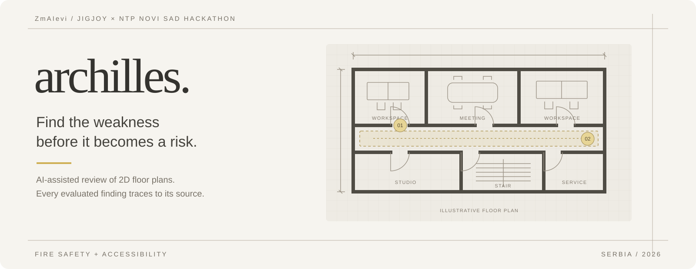
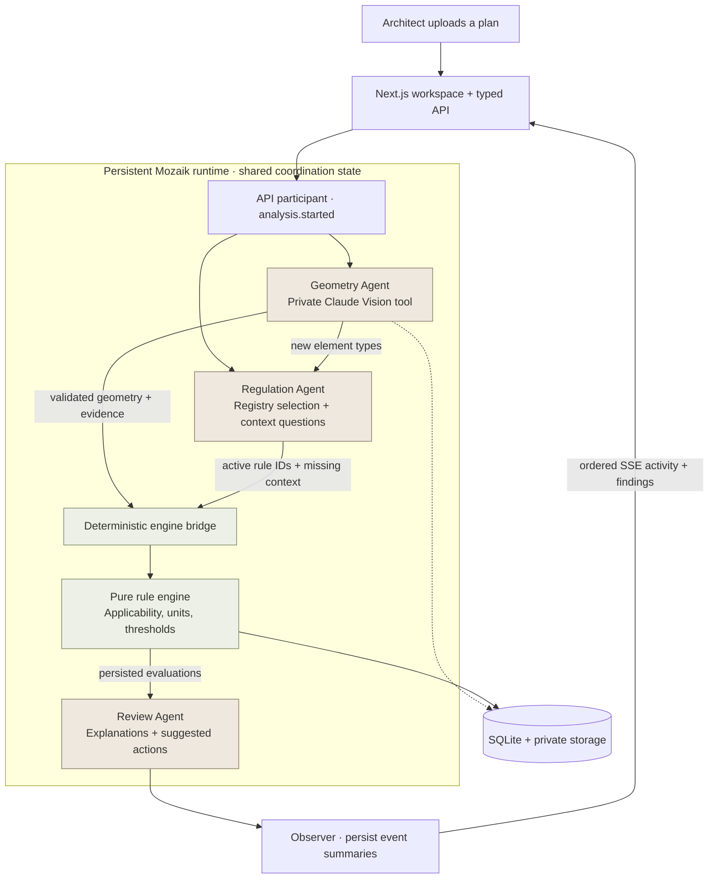
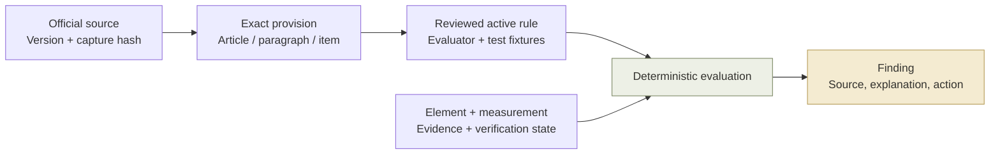

<div align="center">



**A floor plan. Three collaborating agents. Findings you can trace.**

AI-assisted architectural review, grounded in Serbian regulations and a deterministic rule engine.

[](https://github.com/petarpopovic013/archilles/actions/workflows/ci.yml)


[Pitch deck](Archilles.pdf) · [Quick start](#quick-start) · [Agent architecture](#how-the-agents-collaborate) · [Verification](#verify-the-project) · [Technical docs](#explore-the-repository)

</div>

## Why Archilles

An architect's drawing can look complete while still hiding a narrow escape corridor, an inaccessible doorway or a detail that needs another specialist's review. Checking those details means moving between the plan, project classifications and legal provisions. A late discovery means another design revision.

Archilles brings that review onto the floor plan. Upload a 2D drawing, inspect the suggested elements, resolve the evidence that matters and review findings alongside their exact regulatory sources. Try a proposed dimension with **Fix & Recheck** before committing a design change.

Built by **ZmAIevi** for the **JigJoy × NTP Novi Sad Hackathon**. Our pitch reports that **9 of 10 respondents** identified blueprint compliance review as a major problem. This is an exploratory survey of 10 people, not a representative market study. See the [12-slide presentation](Archilles.pdf) for the research, product vision and proposed business model.

> **Current scope:** preliminary fire safety and accessibility review for office projects in Serbia, one selected drawing page at a time. Findings support professional review and do not certify a building.

## What you can do

| In the workspace | What happens |
| --- | --- |
| **Upload a drawing** | Import PDF, PNG or JPEG up to 20 MiB. Select a PDF page and enter the project details you know. |
| **Inspect the plan** | Zoom, pan and select room, corridor, door and other element overlays in the three-panel workspace. |
| **Review AI suggestions** | Inspect boundaries, categories, dimension annotations and uncertainty. Correct geometry directly on the plan. |
| **Answer focused questions** | Resolve units, calibration, entrance selection or missing context. Up to five optional automatic questions appear per page-review round. |
| **Read a finding** | See the affected element, observed condition, requirement, explanation, evidence and source provision. |
| **Try Fix & Recheck** | Change a proposed dimension and reevaluate dependent rules without a model call or a change to the drawing. |
| **Inspect coverage** | See evaluated checks, missing evidence and excluded scope. A summary rating appears only when the assessed set is ready. |

Drawing conventions are interpreted automatically. Corrections preserve their history, and confirmed dimensions reuse stored geometry. Explicit **Read geometry again** starts another paid extraction while preserving human corrections.

## How the agents collaborate

Archilles runs **three Mozaik agent participants** in a persistent Node.js process. Geometry and Regulation react independently to the same analysis event. New element types can change rule selection. Review consumes the engine's persisted evaluations.



| Participant | Responsibility | Boundary |
| --- | --- | --- |
| **Geometry** | Reads the private drawing through a bounded Vision pipeline and suggests elements, labels and evidence. | Cannot approve a physical dimension or edit the drawing. |
| **Regulation** | Selects active rules through registry/applicability code and uses a model to phrase missing-context questions. | Cannot activate rules or decide numerical outcomes. |
| **Review** | Explains persisted evaluations and suggests actions grounded in their evidence. | Cannot change the engine's status or invent a provision. |

The API participant, engine bridge and persistence observer are ordinary runtime services. The bridge waits for usable geometry and rule selection before evaluating each input fingerprint. SQLite owns durable records; Mozaik shared state holds coordination rather than image bytes.

**Collaboration is observable.** The activity panel follows persisted events with agent identities and ordered sequence numbers. [Runtime integration tests](tests/runtime/analysis.test.ts) assert overlapping Geometry/Regulation work, changed selection after geometry arrives and Review consuming a persisted deterministic result. Provider calls are mocked in these tests; the Mozaik runtime, HTTP endpoints and persistence are real.

## Evidence before conclusions

A finding links the design evidence to a versioned rule and its original provision:



The checked-in registry contains **20 active rules across fire protection and accessibility**, as of 31 October 2026. Examples cover corridor and stair widths, accessible door openings, ramps, entrance platforms and circulation around furniture. Applicability still depends on the project and the confirmed role of each element.

| Registry state | Count | Execution |
| --- | ---: | --- |
| `ACTIVE` | 20 | Eligible after source, effective-date and applicability gates. |
| `HUMAN_VERIFIED` | 6 | Blocked because the required geometric evaluators are not implemented. |
| `AI_REVIEWED` | 4 | Outside the executable set. |
| `CANDIDATE` | 5 | Outside the executable set. |

The repository includes captured Serbian fire-protection and accessibility source texts, version metadata, SHA-256 capture hashes, provision references, human-review records and a separate [activation audit](docs/regulations/005-activation.md). See [source captures](fixtures/regulations/originals/), [capture manifest](fixtures/regulations/manifest.json) and [rule fixtures](fixtures/regulations/). These are the project's recorded source versions, not a promise of automatic legal updates.

The engine preserves five outcomes: `PASS`, `FAIL`, `UNKNOWN`, `NOT_APPLICABLE` and `NEEDS_REVIEW`. AI estimates can support a **separately labelled preliminary scenario** with recorded assumptions. They retain their unverified provenance and never become confirmed measurements automatically.

The workspace groups unresolved dependencies instead of presenting every missing value as a separate issue. Its summary rating is `round(100 × good / (good + fail))` for the nonempty, ready evaluated set. Excluded, stale and unresolved checks do not inflate that denominator. The rating describes the assessed checks, not the whole building.

## Quick start

Use **Node.js 24** and npm, matching the [CI configuration](.github/workflows/ci.yml). A live analysis requires an Anthropic-compatible provider key. The ordinary test suite requires no key.

```sh
git clone https://github.com/petarpopovic013/archilles.git
cd archilles
npm ci
cp .env.example .env
```

Configure `.env` locally:

```dotenv
ANTHROPIC_API_KEY=your-provider-key

# Set this only when using a Mozaik gateway key:
# ANTHROPIC_BASE_URL=https://api.app.jigjoy.ai/gateway/anthropic

ARCHILLES_RUNTIME_URL=http://127.0.0.1:4317
ARCHILLES_DATA_DIR=./data
ARCHILLES_VISION_MODEL=claude-sonnet-4-6
ARCHILLES_REVIEW_MODEL=claude-sonnet-4-6
ARCHILLES_AI_BUDGET_USD=20
ARCHILLES_AI_HOURLY_LIMIT_USD=3
```

A direct Anthropic key uses the default Anthropic endpoint. A gateway key must use its matching gateway endpoint. Every laptop needs its own local configuration.

```sh
npm run check:provider
npm run dev
```

`check:provider` makes a tiny paid text request for each distinct configured model and prints a safe result without keys. `dev` starts both the persistent analysis runtime and Next.js. Open the local web address printed by Next.js, normally **http://localhost:3000**. The runtime listens on **127.0.0.1:4317** and migrates SQLite automatically.

<details>
<summary><strong>Separate processes and production build</strong></summary>

For development, run `npm run dev:runtime` and `npm run dev:web` in separate terminals. For a local production build:

```sh
npm run build
```

Then run `npm run start:runtime` and `npm start` in separate terminals. Both processes are required. The MVP runtime accepts loopback addresses only.

</details>

<details>
<summary><strong>Connection and analysis troubleshooting</strong></summary>

| Symptom | What to check |
| --- | --- |
| `PROVIDER_AUTH` | The key must belong to the configured endpoint. Restart after changing `.env`. |
| `PROVIDER_DNS_FAILED`, `PROVIDER_TLS_FAILED`, `PROVIDER_TIMEOUT` | Run `npm run check:provider` on the affected laptop for a focused diagnosis. Check DNS, trusted certificates, clock, VPN or proxy settings. |
| `PROVIDER_MODEL_UNAVAILABLE` | Select a priced model supported by your provider or gateway. |
| `RUNTIME_UNAVAILABLE` | Start the runtime as well as the web process. Check `ARCHILLES_RUNTIME_URL`. |
| `REVISION_SUPERSEDED` | Project evidence changed during analysis. The old result is discarded; a new revision's analysis waits for stale extraction to finish. |
| `BUDGET_EXCEEDED`, `BUDGET_RATE_LIMITED` | The configured total or rolling-hour cost allowance was reached. Inspect recorded spend and limits. |
| A `PARTIAL` result | Inspect the actual run errors and geometry issues. Partial extraction or missing evidence must stay visible. |

The Mozaik message about disabled cloud telemetry does not by itself mean inference is unavailable. This application injects its server-side inference runner independently.

</details>

## A useful demo path

1. **Upload** an office plan and supply the project context you can establish. Leave unknown facts unknown.
2. **Watch the activity** as Geometry and Regulation work and the engine evaluates available evidence.
3. **Inspect an element** and its source-backed finding. Resolve its category, unit or dimension where required.
4. **Try Fix & Recheck** with a hypothetical dimension. Compare the affected result without a new model call.
5. **Inspect coverage** and, when ready, open **Summarise findings** to see the evaluated denominator and failed checks.

The [drawing fixtures](fixtures/plans/README.md) include two deliberately simple office plans, `office-a` and `office-b`, plus a two-page PDF. They are synthetic test drawings. Their disclosed confirmed-reference data is separate from live Vision extraction and does not automatically replace an uploaded plan.

For a repeatable demonstration of data-dependent outcomes, [activation tests](tests/regulatory/activation.test.ts) feed those two plans' distinct confirmed corridor widths through the **actual active registry rule** and assert `FAIL` and `PASS`. Separate [HTTP integration tests](tests/runtime/geometry.integration.test.ts) cover upload, normalization, measurement confirmation and recheck with injected model responses.

## Verify the project

The current local verification, run on **31 October 2026**, passed **513 tests**, TypeScript checking, lint and the production build. The CI badge above reflects the latest workflow state rather than this local snapshot.

```sh
npm test
npm run typecheck
npm run lint
npm run build
```

| Evidence | Where to inspect |
| --- | --- |
| Active-rule provenance, approval and numerical boundary cases | [Regulatory tests](tests/regulatory/) |
| Applicability, missing evidence and separate preliminary scenarios | [Engine tests](tests/engine/) |
| Concurrent participants, event ordering and SSE replay | [Analysis integration](tests/runtime/analysis.test.ts) |
| Scoped tool calls, model failures and revision handoff | [Tool-loop tests](tests/runtime/tool-loops.test.ts) |
| Uploads, source coordinates and original-resolution regions | [Geometry tests](tests/geometry/) |
| Confirmations, persistence and rechecks without repeated Vision | [Runtime integration](tests/runtime/geometry.integration.test.ts) |
| Readiness, excluded scope and summary arithmetic | [Assessment tests](tests/ui/findings-assessment.test.ts) |

For an **explicitly paid** check of the real provider, HTTP, Mozaik and geometry pipeline:

```sh
npm run smoke:geometry
```

The default smoke uses a synthetic drawing, isolated temporary storage and an empty registry. It verifies extraction wiring and does not establish regulatory coverage. `--synthetic-rule` adds a test-only invented rule to exercise the review path.

<details>
<summary><strong>Recognition benchmark and offline evaluation</strong></summary>

```sh
# Paid extraction; writes private observations and overlay images outside the repo.
npm run benchmark:geometry -- \
  --plan fixtures/plans/residential-dimensioned.png \
  --output /tmp/archilles-recognition

# Offline comparison; no provider call.
npm run evaluate:geometry -- \
  /tmp/archilles-recognition/observations.json \
  fixtures/plans/recognition-reference-drafts.json
```

The reference must describe the same drawing and source coordinate frame as the observations. Bundled recognition references are **development drafts**, not human-verified ground truth. A completed pipeline or passing software test does not establish recognition accuracy. See the [recognition verification report](docs/geometry-recognition-verification.md) for measured results and remaining errors.

</details>

## Built for bounded, inspectable analysis

- **Private storage:** uploads and SQLite stay under `data/`, outside public assets and version control. Credentials stay in server-side adapters. Selected drawing content is sent to the configured Vision provider for live extraction.
- **Explicit costs:** total and rolling-hour limits reserve estimated cost before work. Geometry permits at most four logical Vision calls with one shared transient retry. Per-page Geometry reservations cap Vision at **$0.80** and its controller at **$0.20**. Regulation and Review also consume the runtime budget. These are application estimates, not a guarantee of the provider's invoice.
- **Revision safety:** human corrections create new evidence and revisions. Late answers cannot overwrite a newer revision. Restart recovery marks interrupted runs as failed instead of silently replaying paid work.
- **Validated boundaries:** shared Zod schemas validate API, event and AI data. Uploaded documents are untrusted content. Events expose allowlisted summaries rather than raw images or prompts.
- **Deterministic rechecks:** arithmetic, unit conversion, applicability and numerical outcomes remain ordinary TypeScript functions. Dimension-only corrections reuse geometry and structured explanations.

## Explore the repository

| Layer | Technology | Entry points |
| --- | --- | --- |
| Web workspace | Next.js 16, React 19, Konva | [`app/`](app/), [`src/ui/`](src/ui/) |
| Agent orchestration | Mozaik 4.2.0, persistent Node.js | [`runtime/app.ts`](runtime/app.ts), [`participants/`](runtime/participants/), [`mozaik/`](runtime/mozaik/) |
| Drawing understanding | Claude Vision, PDF.js, Sharp | [`src/vision/`](src/vision/), [`src/geometry/`](src/geometry/) |
| Regulatory intelligence | Versioned registry and applicability | [`src/rules/registry/`](src/rules/registry/), [`fixtures/regulations/`](fixtures/regulations/) |
| Evaluation | Pure TypeScript engine | [`src/rules/engine/`](src/rules/engine/) |
| Persistence and transport | SQLite, private files, HTTP + SSE | [`runtime/db/`](runtime/db/), [`runtime/http/`](runtime/http/) |
| Shared contracts | Strict TypeScript + Zod | [`src/domain/`](src/domain/) |

Read the [product requirements](Constitution/PrD.md), [architecture and ADRs](Constitution/Tech.MD), [domain model](Constitution/DB.md), [agent constitution](Agents.MD) and [team ownership agreement](TEAM.md) for implementation decisions and acceptance criteria. Earlier handoffs are historical records; the current code and later ADRs describe the integrated behavior.

## Scope and next steps

The integrated MVP supports drawing review, a reviewed executable registry, real agent orchestration, traceable findings and deterministic rechecks. Automatic geometry still needs human inspection: door/window ambiguity, wall gaps, room overlaps and unresolved boundaries remain explicit issues. Full recognition-accuracy targets have **not** been met across the reference set.

The next engineering priorities are a human-reviewed recognition benchmark, better handling of difficult boundaries and openings, and the six missing geometric evaluators. The product direction in the pitch is to pilot with local architects, offer team access to architecture and engineering firms, then add expert-reviewed rule packs for further jurisdictions. Accounts, billing, BIM integrations, broad multi-floor support and international coverage are future work.

This repository is a **single-user local prototype**. It does not implement hosted multi-tenant access controls or replace an architect, fire-safety specialist or legal reviewer.

---

<div align="center">

**Archilles** · Find the weakness before it becomes a risk.

[Read the pitch](Archilles.pdf) · [Inspect the source](runtime/main.ts) · [Run the checks](#verify-the-project)

</div>
