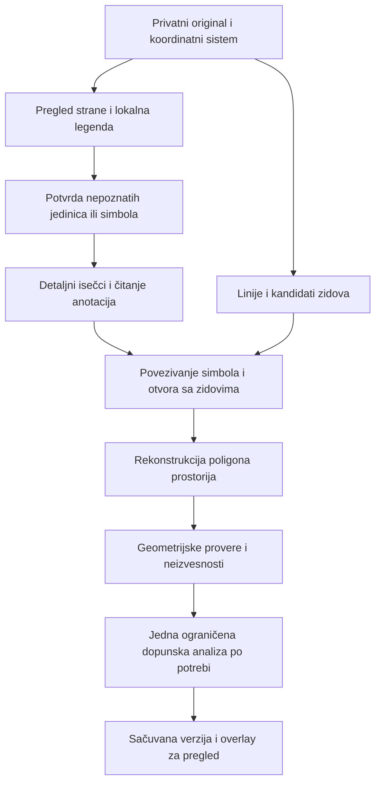

# Plan pouzdanijeg čitanja tlocrta

Datum: 31. oktobar 2026. Status: implementacija u grani `feat/geometry-reading`; ostvareni obuhvat i otvoreni kriterijumi beleže se u `geometry-recognition-verification.md`. Nalazi ispod opisuju početno stanje.

## Dogovoreni obuhvat

Korisnik je izabrao čiste digitalne PDF/PNG/JPG izvoze, kratku početnu potvrdu jedinica/razmere i nejasnih simbola, kao i više ciljano izabranih Claude Vision poziva uz keširanje i unapred ograničen trošak.

Prvi cilj su granice prostorija, vrata/prozori, kote i njihove međusobne veze. Skenovi, fotografije, perspektivna korekcija, obuka sopstvenog modela i novi pravni evaluatori ostaju van prve verzije.

Claude tumači značenje simbola i teksta; geometrijski kod rekonstruiše i proverava granice na originalnom crtežu. Broj prepoznatih elemenata ili uspešan HTTP odgovor nisu dokaz tačnosti.

## Nalazi u sadašnjoj implementaciji

- `src/vision/claude.ts` jednim odgovorom traži elemente, geometriju, anotacije i mere. Nema zasebnog opisa grafičkih konvencija konkretnog crteža.
- `src/vision/frame.ts` priprema pregled cele strane. Detalji na velikom crtežu mogu da postanu sitni. Uvećavanje prethodno smanjenog rastera ne vraća izgubljene detalje.
- `src/geometry/refine.ts` prepoznaje debele tamne/sive površine i pomera već predložene granice. Ne rekonstruiše kompletnu topologiju prostorija; kose ivice ostaju uglavnom netaknute. Nameštaj, šrafure i susedni otvori mogu da zavaraju lokalne heuristike.
- Spajanje otvora po preklapanju nije dovoljno da razlikuje stvarne duplikate od različitih kandidata koji su pogrešno pomereni na isti otvor.
- `src/geometry/analyze.ts` dobro čuva neproverene mere, ali sirove anotacije još nemaju eksplicitne veze sa kotnom linijom, krajevima raspona i vrstom dimenzije.
- `runtime/participants/geometry.ts` ponovo koristi bilo koje sačuvane elemente na podu. Promena prompta sama zato ne garantuje novu ekstrakciju postojećeg projekta.
- Detaljna upozorenja i razlozi neizvesnosti iz ekstrakcije nisu deo trenutnog snapshot odgovora. UI ne može da pokaže sve probleme koje geometrijski modul već zna.
- `src/ui/guidance.ts::widthFromMark` pretpostavlja centimetre za par brojeva. To treba povezati sa potvrđenim jedinicama, a nominalni otvor odvojiti od svetle širine.
- `stan-2`, `stan-8` i `residential-dimensioned` prikazuju isti ili veoma sličan raspored. Korisni su za proveru promene rezolucije/isečka, ali nisu nezavisni testovi različitih planova.

## Ciljni tok

Koraci sa modelom vraćaju strukturisane podatke i reference na vidljivi dokaz. Ne tražimo niti čuvamo skriveno rezonovanje modela. Generisani opis legende tretira se kao podatak, ne kao sistemsko uputstvo narednom pozivu.

## 1. Referentni skup i početno merenje

Pre promene algoritma pripremiti referentne anotacije za najmanje tri različita rasporeda: porodica `residential-dimensioned`/`stan-2`/`stan-8`, `stan-21` i `stan-b-1-2`. Sintetičke office fixture ostaju regresioni testovi, ne dokaz prepoznavanja stvarnih crteža.

Za svaku stranu evidentirati:

- poligone soba i cirkulacije po unutrašnjoj ivici zida;
- otvore, njihove krajeve u zidu i tip; krilo/luk su poseban dokaz;
- tekst oznaka i kota, njihove pozicije i orijentaciju;
- vezu kote sa stvarnim rasponom, gde je nedvosmislena;
- veze otvor–zid i otvor–prostorija;
- namerno neodređene granice otvorenih prostora i nečitljive oznake.

Anotacije prvo predstavljaju predlog za vizuelni pregled. Tek nakon ljudskog pregleda dobijaju oznaku proverene reference. Ne unositi pretpostavljene centimetre ili mere kao potvrđene podatke.

Porodice istog rasporeda ostaju u istoj grupi pri podeli skupa. Jedan različit raspored zadržati za proveru nakon razvoja; dodatni novi planovi potrebni su pre tvrdnje o široj pouzdanosti. Ne prilagođavati algoritam imenu fajla ili očekivanom broju soba.

Isporučiti privatni izveštaj sa preklopljenim konturama, propuštenim/lažnim elementima i tabelom grešaka. Razvojni izveštaji ne ulaze u javne assete niti raw AI logove.

## 2. Original, PDF i precizne koordinate

Zadržati original i jedan kanonski source sistem. Za slike je to orijentisana izvorna slika; za PDF postojeći crop/rotation sistem rendera na 144 DPI. Viewer raster, pregled za Claude i detaljni isečci imaju odvojene eksplicitne transformacije ka tom sistemu.

Detaljne isečke generisati iz privatnog originala, odnosno ponovnim renderovanjem PDF regiona, a ne iz već smanjenog 2048 px pregleda. Veća render rezolucija ne menja kanonske koordinate niti uspostavlja fizičku razmeru. Uvesti limite dimenzija, broja isečaka, dekodiranih piksela i vremena renderovanja.

Za digitalni PDF prvo koristiti ugrađeni tekst sa `getTextContent`; proveriti poklapanje njegovih koordinata sa rasterom. Tekst bez pouzdane pozicije ostaje nepotvrđen kandidat. `getOperatorList` omogućava pokušaj izdvajanja grafičkih poteza, ali nije gotov parser zidova: matrice, clip, boja, debljina i grupisanje moraju posebno da se obrade. Taj put mora imati raster fallback.

Claude vraća apsolutne piksele cele poslate slike. Ako postoje lenjiri/margine, njihova translacija se oduzima u kodu. Testirati redosled transformacija za crop, resize, rotaciju i marginu. Ne tražiti od modela da mentalno preračunava globalne koordinate.

Proveriti modelsku granicu duge ivice i broj vizuelnih tokena za ceo poslati okvir. Trenutna procena površinom nije dovoljna kao budući ugovor za sve modele/gateway-e. Novu opciju za odbijanje automatskog resize-a koristiti samo ako je podržavaju instalirani SDK i konkretni endpoint.

## 3. Mini legenda po crtežu

Prvi Vision prolaz vraća pregled i strukturisanu legendu specifičnu za stranu:

| Deo legende | Šta beležimo |
|---|---|
| Zidovi | Puna/šrafirana ispuna, parovi linija, približna debljina u pikselima, primeri |
| Vrata | Krilo, luk otvaranja, klizni simbol, oznaka, primer sa dokazom |
| Prozori | Paralelne linije u zidu, oznake, parapetne/visinske napomene |
| Kote | Kotne i pomoćne linije, završeci, decimalni zapis, rotiran/stacked tekst |
| Oznake | Broj sobe, šifra stolarije, visinska kota, oznaka detalja |
| Oprema/nameštaj | Krevet, ormar, sto, sanitarije i simboli koji mogu ličiti na zid |
| Jedinice/razmera | Doslovni vidljivi zapis i lokacija; eksplicitno nepoznato ako nedostaje |

Svaki uzorak ima referencu na isečak i source geometriju, predloženo značenje, alternativu kada postoji i stanje potvrde. Postojeća nacrtana legenda ili tabela imaju prednost kao dokaz, uz proveru da važe za izabranu stranu.

Oznaka V/P, visina otvora ili sličnost sa primerom ne postaju samostalni dokaz tipa. Vrata bez šifre i prozori sa šifrom moraju biti podržani. Simbol sa druge strane/projekta ne nasleđuje potvrdu automatski.

Korisnik vidi mali panel sa primerima i odgovara samo na stvarno nepoznato: npr. jedinica golih kota, značenje nejasnog simbola ili nedvosmisleno označen kalibracioni raspon. Izbor centimetara ne potvrđuje sve dimenzije niti povezuje svaku kotu sa elementom.

## 4. Detaljno čitanje simbola i kota

Planer isečaka deli područje tlocrta u preklapajuće regione. Biranje ne zavisi samo od prvog Claude odgovora: mora pokriti čitav tlocrt da ne propusti vrata koja prvi prolaz nije primetio. Nejasna oblast dobija kontekst okolnog zida i prostorija, ne samo izdvojen broj.

Detaljni prolaz dobija originalni region, mali kontekst celog plana i odabrane uzorke legende. Rezultat sadrži kandidate, doslovni tekst, source reference, orijentaciju i relacije. Nije zadatak modela da računa metre ili rekonstruiše sve temene tačke sobe.

Razdvojiti:

- broj sobe od oznake vrata/prozora i visinske kote;
- room span od clear width, parapeta i visine otvora;
- nominalnu dimenziju otvora od stvarne slobodne širine;
- doslovno pročitani tekst od protumačene vrednosti/jedinice;
- nepročitani tekst od tvrdnje da kote nema.

Kotna anotacija dobija sopstveni zapis: raw tekst, lokaciju, pravac, predložene krajeve raspona, jedinicu i njen dokaz, vrstu dimenzije, vezu sa kandidatom i neizvesnost. Postojeći Metric enum se ne proširuje proizvoljno za svaki broj; geometrijske anotacije mogu ostati van pravnih Measurement zapisa.

Povezivanje koristi kotnu/pomoćnu liniju, orijentaciju, krajeve i kontekst. Sama blizina teksta otvoru nije dovoljna. Sukob dve kote se prikazuje, ne rešava prosekom ili izborom zgodnijeg broja.

## 5. Rekonstrukcija zidova i prostorija

Za PNG/JPG izdvojiti kandidate zidova kombinacijom ispune, kontinuiteta, parova ivica i lokalne debljine. Šrafure, sivi zidovi i tankolinijski zidovi traže zasebne slučajeve. Jedan luminance prag ne sme biti jedini kriterijum.

Napraviti strukturu zidnih segmenata, spojeva i kandidata otvora. Iz nje formirati granice prostora. Claude predlaže semantičke identitete i tačke unutar prostora; konture se izvode iz zidnih lica. Pomoćne tačke ne smeju završiti u nameštaju ili zidu bez provere.

Otvorena vrata se privremeno premošćavaju isključivo za izdvajanje prostorije. Stvarni otvor i veza susednih prostorija ostaju zabeleženi. Ne zatvarati svaki beli prekid u maski: može biti prolaz, prozor ili nečitljiv deo zida.

Kontura prati unutrašnje lice zida, uključujući L-oblik, niše i kose delove. Ne svoditi sobu na bbox. Nameštaj nije granica sobe; prepreke i stubovi su zasebni objekti. Ako su potrebni poligoni sa rupama, uvesti eksplicitan geometrijski ugovor pre njihovog korišćenja; ne gurati ih u postojeći jednostavan poligon.

Za otvorene kuhinje/dnevne boravke ili hodnik spojen sa sobom postoji razlika između fizički odvojene prostorije i funkcionalne zone. Nevidljiva granica može biti predlog sa oznakom da je izvedena; ne predstavlja se kao pronađen zid. Kada dokaz nije dovoljan, zadržati jedinstven prostor ili tražiti potvrdu podele.

Vrata/prozori se postavljaju na identifikovani segment zida i konkretan otvor. Sačuvati krajeve, orijentaciju i dokaz krila/luka. Duplikati se spajaju prema identitetu otvora i dokazima, ne samo prema IoU pomerenih bbox-ova.

## 6. Mere i kalibracija

Jednom potvrđena jedinica omogućava tumačenje golih numeričkih oznaka unutar potvrđenog opsega. Sama po sebi ne uspostavlja m/px. Za kalibraciju korisnik proverava konkretna dva kraja i pripadajuću kotu; svaka zona različite razmere mora biti odvojena ili blokirana.

Pouzdana direktna kotna vrednost ima prednost kao dimenzionalni dokaz. Merenje iz piksela dozvoljeno je samo uz potvrđenu kalibraciju i proverene krajeve. Razlika sa kotom postaje konflikt. Prikazati izvor, preciznost/rezoluciju i nedostajuću potvrdu.

Model ne računa konverzije. Deterministički kod normalizuje m/cm/mm, decimalni zarez i procente. Vrata 80/200 ostaju nominalni par dok korisnik ne potvrdi stvarnu svetlu širinu; ne oduzimati izmišljenu debljinu štoka.

Sve nove fizičke mere ostaju UNVERIFIED dok čovek ne potvrdi relevantni dokaz. Ne uvoditi globalno dugme koje slepo potvrđuje sve dimenzije. Pojedinačna potvrda ostaje brza, a grupna je moguća samo za jasno definisan i prikazan obuhvat.

## 7. Provere i ograničena dopunska analiza

Determinističke provere obuhvataju validne poligone bez samopresecanja, bounds, neželjena preklapanja, granice koje prolaze kroz dokazani zid, otvore van zidova, nejasnu vezu prostorija i konflikte anotacija. Provera da svaki prostor ima vrata je signal za pregled, ne pravilo da se vrata izmisle.

Neuspešna provera bira precizan region za jednu dopunsku Vision analizu ako je preostao budžet. Dopunski rezultat je novi predlog i ponovo prolazi geometrijske provere. Model ne odlučuje sam da je njegova prethodna geometrija tačna. Bez beskonačnih ciklusa samokritike.

Razlikovati uspešno završen rad servisa od spremnosti geometrije za upotrebu. Nepročitani regioni, odbačeni kandidati, nerešene podele i pozicioni problemi moraju ostati u sačuvanom dijagnostičkom rezultatu i UI-ju. Za problem jednog elementa zadržati ostatak rezultata uz jasan problematični region.

## 8. Pozivi, trošak, keš i istorija

Početni predlog limita, koji se podešava nakon merenja na fixture-ima:

- najviše četiri logička Vision poziva po strani: pregled/legenda, najviše dva paketa detalja i jedna ciljano ograničena dopuna;
- najviše jedan dodatni provider pokušaj za prolaznu grešku ukupno kroz tu ekstrakciju;
- najviše osam detaljnih regiona, uz ograničen broj slika/tokena u svakom paketu;
- plafon od USD 1 po kompletnoj geometrijskoj obradi strane, uključujući kontroler i retry rezervu; ovo je ograničenje, ne prognoza cene;
- postojeći ukupni USD 20 i rolling-hour USD 3 limit ostaju dodatni, stroži globalni uslovi;
- zasebni timeout-i za render, model i ceo pipeline, sa otkazivanjem/zatvaranjem rada;
- kada strana ne može potpuno da se obradi u limitima, vratiti vidljiv delimičan rezultat i tačan neobrađen obuhvat.

Orkestracija ostaje u jednom Geometry učesniku. Jedan njegov Mozaik alat pokreće ograničen pipeline; unutrašnje faze imaju sopstvene stvarne događaje i evidenciju troška. Ne uvoditi nove LLM učesnike za svaki tip simbola.

Svaki poziv rezerviše trošak pre provider pristupa. Evidentirati i nevalidne/odbačene/zakasnele odgovore i potrošnju prethodnih uspešnih faza kada kasnija faza padne. Ne prijavljivati jedan Vision poziv ako pipeline ima četiri. Gateway cene i podržani modeli proveravaju se pre live merenja.

Keširati zasebno preprocesiranje, pregled/legendu i detaljne faze. Ključ uključuje privatni project/drawing scope, hash, stranu, crop/transform, model, verziju parsera/prompta i fingerprint potvrđene legende/jedinica. Promena legende invalidira zavisno tumačenje; promena jedne potvrđene mere ne invalidira čitanje slike. Ne deliti privatne rezultate među projektima.

Eksplicitna nova ekstrakcija postojeće strane mora izabrati novu extraction verziju i sačuvati prethodnu. Potvrđene korekcije se ne prepisuju. Nepoklopljeni novi/stari elementi ne povezuju se proizvoljno: stabilni ID se čuva samo uz proverljivo poklapanje, a sporni slučaj ide na pregled.

Ako se projekat promeni, kasni rezultat stare revizije ne ulazi u novu. Promena/ponovno tumačenje geometrije i potvrda korisnika imaju zapis revizije. Fix & Recheck ostaje potpuno deterministički, bez Vision poziva.

## 9. Ugovori, runtime i UI

Pre produkcione implementacije uskladiti Constitution/DB.md, Constitution/Tech.MD, Agents.MD i Constitution/PrD.md u izdvojenoj promeni ugovora. Sadašnji limit jednog Vision poziva je u konfliktu sa potrebnim fazama; korisnik je u ovoj sesiji izričito izabrao više ograničenih poziva. Zameniti ga opisanim konačnim limitima, ne tiho zaobići.

Predloženi novi zapisi: verzija ekstrakcije, lokalna legenda, potvrda jedinica/kalibracije, kotne anotacije, zidovi/otvori i njihove veze, dijagnostika i pokrivenost regione-po-region. Njihovi konačni nazivi i enum-i definišu se samo u zajedničkim Zod ugovorima. Pravni statusi i lifecycle se ne menjaju.

API treba da podrži čitanje/prihvatanje legende, potvrdu kalibracionog raspona, geometrijski pregled i eksplicitnu novu ekstrakciju. Geometry snapshot dobija dijagnostiku i potrebne potvrde, a SSE sažetke stvarnih faza. Semantika zahteva mora razlikovati nastavljanje već urađenih faza od novog plaćenog čitanja.

SQLite ostaje sistem evidencije, sa migracijama, istorijom i referencama. Privatni isečci se ne vraćaju kao putanje; UI ih dobija preko privatnog API-ja. In-memory Mozaik stanje služi za koordinaciju.

UI dobija jednostavan pregled legende/jedinica, zasebne slojeve prostorija/otvora/kota, vidljive nejasne regione i korekciju pogrešne granice ili vrste objekta. Vertex uređivanje mora imati server-side bounds/topology validaciju i novu reviziju. AI geometrija ostaje predlog do potvrde. Read-only označavanje greške može prethoditi kompletnom editoru.

## 10. Redosled isporuke

| Korak | Promene | Uslov završetka |
|---|---|---|
| A: Merenje | Referentne anotacije, izvoz overlay-a, benchmark | Isti ulaz daje pregledljive greške; rasporedi nisu duplirani u podeli skupa |
| B: Ugovori | Faze, legenda, dijagnostika, pozivi/budžet, istorija | Zod i četiri constitution dokumenta se slažu; stari projekti ostaju čitljivi |
| C: Izvor i koordinate | Isečci originala, PDF tekst, potpune transformacije | Round-trip i stvarni marker pikseli rade za resize/crop/rotaciju/marginu |
| D: Prvi celovit primer | Legenda, detalji, osnovni zidovi/otvori i sobni poligoni | Jedna stvarna strana prolazi privatni upload–analiza–overlay tok sa vidljivim problemima |
| E: Robusnost | Kose/šuplje/šrafirane granice, kote, topologija, dopuna | Drugi i treći različit raspored prolaze iste kriterijume bez filename uslova |
| F: Integracija | Potvrde, dijagnostika, nova ekstrakcija, korekcije | Korisnik vidi/koriguje grešku; istorija i keš rade; recheck nema AI poziv |
| G: Prihvatanje | Bounded live provera, izveštaj, kompletne regresije | Objavljeni stvarni rezultati po planu, sa ograničenjima i potrošnjom |

Prvi PDF vektorski eksperiment raditi u C; kompletan parser vektorskih putanja nije blokada za prvi raster primer D. Ako postojeći raster pristup ne zadovolji kriterijume, zaustaviti širenje UI-ja i odluku o dodatnom segmentacionom modelu zasnovati na izmerenim greškama.

## 11. Predloženi kriterijumi prihvatanja

Ovo su ciljevi koje treba potvrditi prema pregledanim referencama, ne već ostvareni rezultati.

- Na fiksnom release skupu sva nedvosmislena vrata i prostorije su pronađeni, bez lažnog prevođenja referentnih prozora u vrata. Nejasni slučajevi eksplicitno su izdvojeni, a propušteni objekti ne nestaju iz statistike.
- Poklapanje poligona (IoU) najmanje 0,95 za jednostavne zatvorene sobe i 0,90 za složenije granice; objaviti rezultat za svaku sobu, ne samo prosek.
- Objaviti p95 odstupanje granice u source pikselima i u odnosu na dijagonalu strane; početni cilj najviše 0,3% dijagonale. Posebno prikazati lokalnu grešku krajeva vrata u odnosu na debljinu zida, jer dobar sobni IoU ne dokazuje tačnost malog otvora.
- Doslovni tekst svih jasno čitljivih ključnih kota/oznaka u referencama je očuvan; ispravnost čitanja i ispravnost povezivanja sa rasponom mere se odvojeno. Nejasno čitanje nikada ne postaje potvrđena mera.
- Nema neobjašnjenih preklapanja soba, geometrije van strane, izmišljenog zida na otvorenoj vezi ili neprimetno odbačenog kandidata.
- Posebno testirati neoznačena vrata kupatila, prozor uz sobu 3, obrnute parove 80/200 i 200/80, rotirane kote, parapet P=90cm, dvokrilna vrata, šrafure, sivi zid i nameštaj uz zid.
- Promena rezolucije, manji crop, rotacija i JPEG degradacija testiraju istu source geometriju; ne broje se kao novi nezavisni rasporedi.
- Korisnik može da ispravi pogrešnu granicu i potvrdi dokaz bez novog celog Vision čitanja.
- Limiti poziva, retry-a i potrošnje važe i u slučajevima greške, promene revizije i istovremenih zahteva.
- Potvrda mere i hipotetički recheck koriste sačuvanu geometriju; recheck ima nula modelskih poziva.
- Svi postojeći testovi prolaze. Za pogođene module dodati smislene testove i izvršiti typecheck, lint i build; live rezultate jasno odvojiti od mock testova.

## Izvori za tehničke odluke

- [Anthropic: Vision](https://platform.claude.com/docs/en/build-with-claude/vision): ograničenja prostorne lokalizacije i rezolucije.
- [Anthropic: Coordinates and bounding boxes](https://platform.claude.com/docs/en/build-with-claude/vision-coordinates): apsolutni pikseli, resize/padding i detaljni crop-ovi.
- [Mozilla PDF.js: PDFPageProxy](https://mozilla.github.io/pdf.js/api/draft/module-pdfjsLib-PDFPageProxy.html): tekst, operatori i viewport. Potvrđeno i u lokalnim deklaracijama instaliranog `pdfjs-dist`.

Nije izvršen novi plaćeni model poziv u pripremi ovog plana. Prethodno izvršen `npm test` u ovoj sesiji: 468 prošlo, 0 neuspešnih. To potvrđuje postojeću regresionu osnovu, ne tačnost budućeg prepoznavanja.
